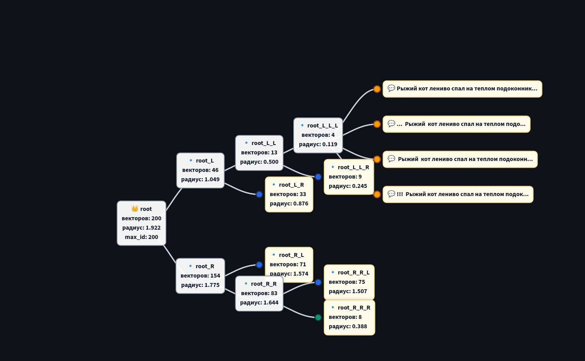
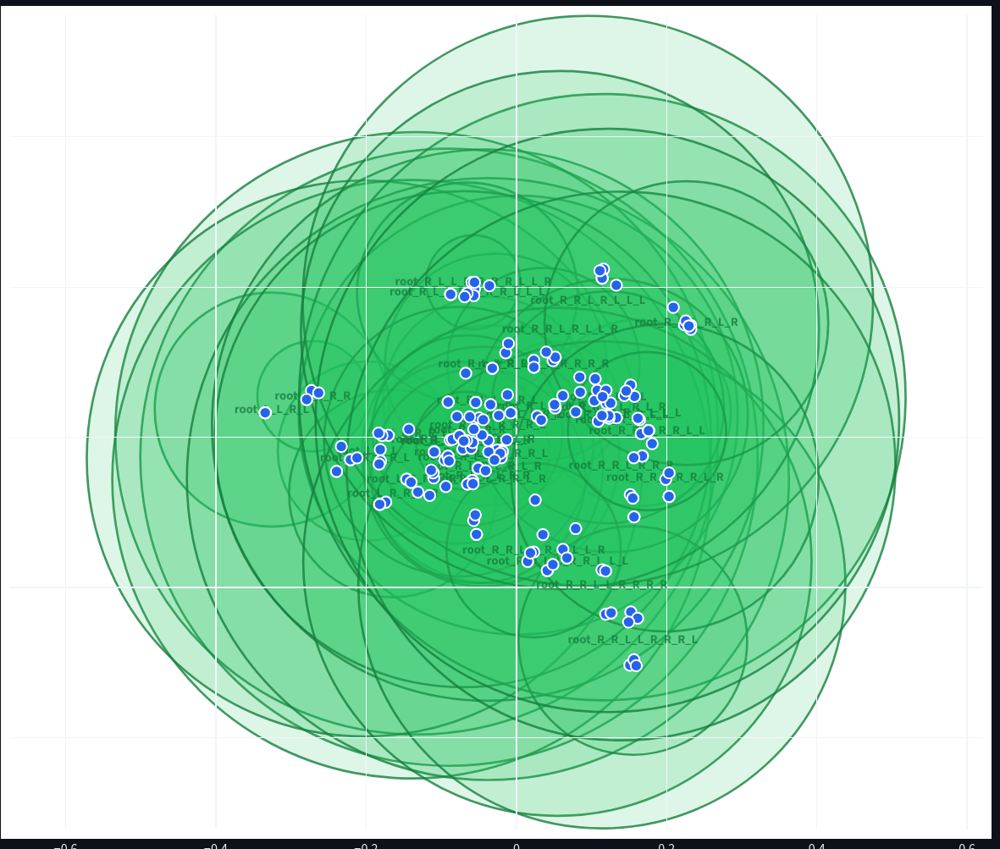

# Semantic Vector Search Engine

Семантический поисковый движок на базе плотных векторных представлений текста (эмбеддингов) и кастомной древовидной структуры метрического индексирования (**Ball Tree**) для эффективного поиска $k$ ближайших соседей ($k$-NN).

Система реализована с нуля на Python и NumPy.

---

## Архитектура и ключевые особенности

* **Векторизация текстов:** Интеграция мультиязычной модели `intfloat/multilingual-e5-small` (`sentence-transformers`), сопоставляющей предложениям 384-мерные нормализованные векторы семантического пространства.
* **Кастомный Ball Tree индекс:**
  * Иерархическое разбиение векторного пространства на гиперсферы с динамическим пересчетом центроидов и радиусов.
  * Алгоритм полярного сплита переполненных листьев на основе поиска пары максимально удаленных векторов через матричные операции NumPy.
  * Эффективная фильтрация ветвей при поиске с использованием неравенства треугольника и очереди с приоритетом (`min-heap`).
  * Теоретическая сложность поиска - $O(k \cdot \log N)$ против $O(k \cdot N)$ у наивного сканирования.
* **Интерактивная визуализация:**
  * **Дерево индекса (ECharts):** динамический граф структуры узлов с индикацией радиусов, глубины и трассировкой пути обхода при поиске.
  * **Проекция пространства (PCA + Plotly):** снижение размерности векторов из 384D в 2D через сингулярное разложение (SVD) с наложением границ гиперсфер каждого узла.
* **Синтетическая аугментация:** Пайплайн зашумления и расширения корпуса текстов для валидации устойчивости семантического поиска к опечаткам и пунктуационному шуму.

---

## Визуализация работы

### Иерархическая структура дерева
Отображение распределения документов по узлам, радиусов сфер и путей обхода:


### 2D-проекция семантического пространства и гиперсфер
Визуализация взаимного расположения кластеров векторов и перекрытия ограничивающих сфер (исследование эффекта высокой размерности пространства):


---

## Быстрый старт

Проект управляется через современный менеджер пакетов `uv`.

### 1. Установка окружения
```bash
uv sync
```

### 2. Запуск интерактивного UI
```bash
uv run streamlit run st_demo.py
```
Приложение будет доступно в браузере по адресу `http://localhost:8501`.

### 3. Линтинг и проверка типов
```bash
make check
```
